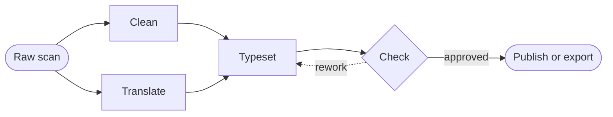

<div align="center">

# Grimoria

**The back-office where a scanlation team turns raw scans into finished chapters.**


</div>

## Why

A few years ago, I promised my scanlation team a proper tool to work
together. Grimoria is me keeping that promise: a personal challenge, and an
attempt to give the team a fresh boost.

## How a chapter gets made

Every page goes through four steps. Clean and translation run in parallel,
typesetting waits for both, and a failed check sends the page back with a
comment.



Members pick the steps that match their roles, chapter by chapter. Leads
create chapters, invite people, and decide when to publish. Key events land in
the team's Discord.

## Status

The API is being built step by step, following the
[roadmap](docs/plans/backend-roadmap.md).

- [x] Project scaffold, tests and CI
- [x] Environment, PostgreSQL and Celery
- [ ] Supabase authentication
- [ ] Teams, members and invites
- [ ] Chapters and the production pipeline
- [ ] Discord notifications
- [ ] Publishing and export
- [ ] Web app (Next.js)

## Run the API locally

<details>
<summary>Requirements: Python 3.12 and Docker</summary>

From `apps/api`:

```bash
python -m venv .venv
.venv/Scripts/pip install -r requirements.txt   # .venv/bin/pip on Linux/macOS
cp .env.example .env                            # then set SECRET_KEY (see the comment in the file)
docker compose up -d                            # PostgreSQL and Redis
.venv/Scripts/python manage.py migrate
.venv/Scripts/pytest
```

Start the Celery worker (on Windows, `--pool=solo` is required):

```bash
.venv/Scripts/celery -A config worker --pool=solo -l info
```

</details>

## Repository

```
apps/api/      Django REST API
docs/specs/    product specification (French)
docs/plans/    roadmap (French)
```

Every change goes through a pull request to `master`, and the CI must pass
before merging. Commits follow
[Conventional Commits](https://www.conventionalcommits.org/).

## License

All rights reserved. The code is public for reference; reuse requires
permission.
